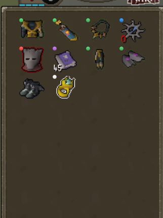

# Dot Tags

Tag inventory items with a small colored dot in the corner instead of outlining the whole item.

## Usage

1. Hold **Shift** and right-click an item in your inventory (or the bank's inventory panel).
2. Choose **Dot tag** and pick one of six color groups.
3. To clear a tag, choose **Dot tag → Remove dot**.

Tags are saved per item, so every copy of that item gets the same dot.

## Settings

| Setting | Default | Description |
|---|---|---|
| Corner | Top left | Which corner of the item the dot sits in |
| Dot size | 5 | Diameter in pixels (3–16) |
| Dot style | Glossy | Glossy (soft gradient with a highlight) or Flat (plain circle) |
| Opacity % | 70 | How see-through the dot is |
| Dark border | Off | Thin dark ring around the dot |
| Show in bank | Off | Also show dots on items in the main bank view |
| Group 1–6 | Red, green, blue, yellow, purple, white | Color of each tag group |
